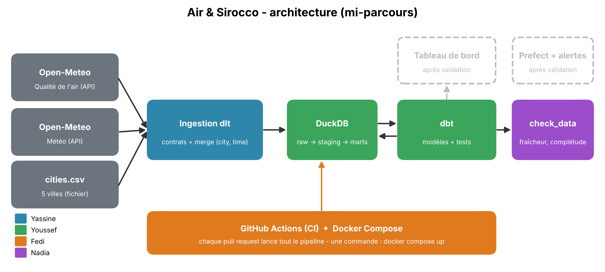

# 🌬️ Air & Sirocco

**La qualité de l'air en Tunisie, vérifiée chaque jour.**

Air & Sirocco récupère automatiquement, chaque jour, la qualité de l'air et la météo
de 5 villes tunisiennes (Tunis, Sfax, Sousse, Gabès, Tozeur), vérifie les données à
chaque étape, et indique à tout moment si elles sont **fraîches et complètes**.

Projet DataOps : **Yassine** (ingestion), **Youssef** (dbt), **Fedi** (CI + Docker),
**Nadia** (santé des données, architecture, présentation).

---

## 1. Problématique

Le **sirocco**, vent chaud venu du sud, transporte de la poussière du Sahara. Pendant
ces épisodes, les particules fines (PM10, PM2.5) montent fortement et touchent d'abord
les personnes fragiles : enfants, personnes âgées, asthmatiques.

Aujourd'hui, il n'existe **aucun suivi fiable et ouvert, ville par ville**, de ces épisodes.

> **Exemple réel, trouvé dans nos propres données :** Sfax, 13 novembre, 11h →
> **PM10 = 90,7 µg/m³**, le double du seuil OMS (45 µg/m³).

## 2. Sources de données

| Source | Contenu | Fréquence | Pourquoi |
|---|---|---|---|
| [Open-Meteo Air Quality API](https://open-meteo.com/en/docs/air-quality-api) | PM2.5, PM10, poussière, NO₂, ozone | horaire | gratuite, **sans clé**, couvre les 5 villes |
| [Open-Meteo Forecast API](https://open-meteo.com/en/docs) | température, humidité, vitesse et direction du vent | horaire | même fournisseur, même grille horaire |
| `dbt_project/seeds/cities.csv` | 5 villes : coordonnées, gouvernorat, population | fixe | référentiel des villes suivies |

*Pourquoi pas OpenAQ ?* Clé d'API obligatoire et très peu de capteurs en Tunisie.

## 3. Questions métier

1. **Dépassements OMS** : combien d'heures / de jours chaque ville dépasse-t-elle les
   seuils OMS (PM10 : 45 µg/m³, PM2.5 : 15 µg/m³ en moyenne journalière) ?
2. **Effet du vent du sud** : la pollution aux particules monte-t-elle quand le vent
   vient du sud (sirocco) ?
3. **Fiabilité des prévisions** : les prévisions de qualité de l'air sont-elles
   proches des valeurs observées ensuite ?

## 4. Architecture



Une couleur = un membre de l'équipe ; les cases en pointillés viendront après la validation.

```
API Open-Meteo → ingestion dlt + contrats → DuckDB (raw → staging → marts)
              → dbt + tests → check_data (santé)        CI GitHub + Docker relancent tout
```

Le détail, étape par étape : [docs/architecture.md](docs/architecture.md).

**Trois barrières empêchent un chiffre faux d'arriver :**
1. le **contrat** à l'entrée (`contracts/*.yml`) : une valeur absurde bloque le chargement ;
2. les **tests dbt** (pas de doublons, pas de valeurs manquantes…) ;
3. la **CI**, qui bloque toute pull request rouge.

## 5. Lancer le projet

### Avec Python (Python 3.10 à 3.12)

```bash
git clone https://github.com/yassine169/air-sirocco.git
cd air-sirocco
python -m venv .venv
# Windows : .venv\Scripts\activate     Mac/Linux : source .venv/bin/activate
python -m pip install -r requirements.txt

pytest -q                                # 6 tests du contrat
python -m ingestion.pipeline_openmeteo   # charge raw.air_quality et raw.weather
python scripts/check_data.py             # ✅ Données fraîches et complètes
```

### Avec Docker

```bash
docker compose up --build
```

## 6. Santé des données (observabilité)

`scripts/check_data.py` répond à la question : *peut-on faire confiance aux données
en ce moment ?*

| Vérification | Règle | Pourquoi |
|---|---|---|
| Fraîcheur | dernier chargement il y a **moins de 26 h** | pipeline quotidien (24 h) + 2 h de marge |
| Villes | les **5 villes** sont présentes | une ville manquante fausse les comparaisons |
| Valeurs manquantes | **moins de 20 %** de PM2.5 vides | trop de trous = moyennes peu fiables |

Exemple de sortie :

```
=== Rapport de santé des données ===
raw.air_quality    360 lignes | 5 villes | dernier chargement il y a 0.0 h
raw.weather        360 lignes | 5 villes | dernier chargement il y a 0.0 h
PM2.5 manquants : 0.0%

✅ Données fraîches et complètes
```

En cas de problème, le script liste les anomalies et s'arrête avec le **code 1** :
dans la CI et dans Docker, le pipeline devient rouge.

## 7. Structure du dépôt

| Dossier / fichier | Rôle | Responsable |
|---|---|---|
| `ingestion/` | appels aux API, validation du contrat, chargement dlt (merge sur `city, time`) | Yassine |
| `contracts/` | contrats de données (types, bornes min/max) | Yassine |
| `tests/` | tests du contrat (pytest) | Yassine |
| `dbt_project/` | modèles staging → marts + tests dbt | Youssef |
| `.github/workflows/`, `Dockerfile`, `docker-compose.yml` | CI et conteneur | Fedi |
| `scripts/check_data.py` | santé des données | Nadia |
| `docs/` | schéma et explication de l'architecture | Nadia |
| `presentation/` | déroulé de la soutenance | Nadia |
| `data/` | entrepôt `warehouse.duckdb` (non versionné, se reconstruit) | — |

## 8. Sécurité

Aucun secret dans le dépôt : Open-Meteo ne demande pas de clé, et `.env` est ignoré
par Git (voir `.env.example`).

## 9. La suite (après le mi-parcours)

- Orchestration quotidienne avec **Prefect** ;
- **alerte Discord** quand `check_data.py` échoue ;
- **alerte avant l'épisode** de poussière, grâce aux prévisions ;
- détection de **série bloquée** (un capteur qui renvoie toujours la même valeur) ;
- **tableau de bord** et page publique « santé des données » ;
- question 3 (fiabilité des prévisions) et déploiement AWS par la CI.
