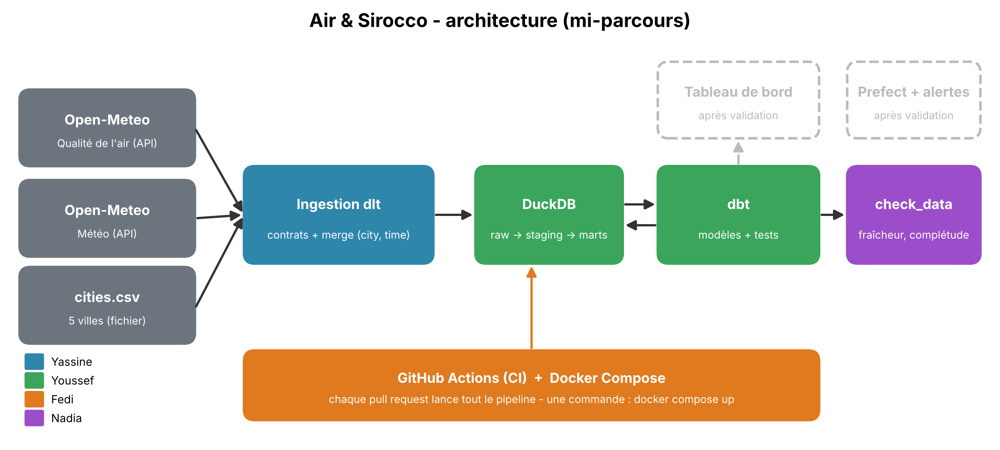
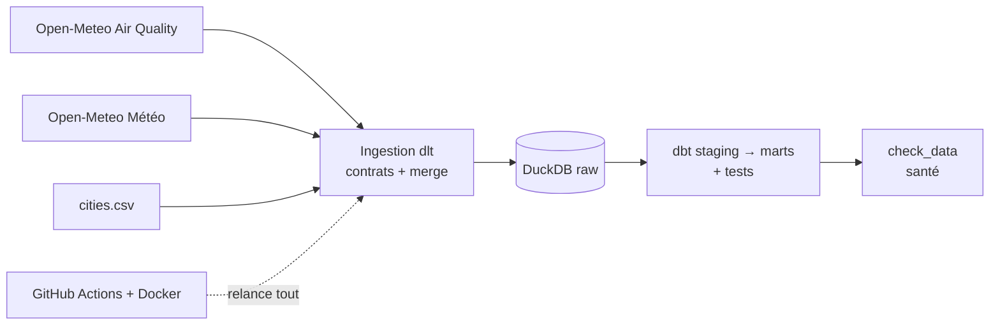

# Architecture

## Le chemin d'une donnée, étape par étape

1. **Sources.** Deux API Open-Meteo (qualité de l'air, météo) et un fichier des villes.
2. **Ingestion (dlt).** Le script appelle les API pour chaque ville. Avant de charger,
   il vérifie chaque ligne avec le **contrat** (`contracts/*.yml`) : si une valeur est
   absurde, tout s'arrête. Le chargement fait un **merge** sur la clé (ville, heure) :
   relancer ne crée pas de doublons.
3. **Entrepôt (DuckDB).** Un fichier `data/warehouse.duckdb` avec 3 couches :
   `raw` (données brutes), `staging` (nettoyées), `marts` (prêtes pour répondre aux questions).
4. **Transformation (dbt).** Les modèles SQL construisent staging et marts, et les
   **tests** vérifient les données (pas de doublons, pas de valeurs manquantes...).
5. **Santé des données.** `scripts/check_data.py` vérifie que les données sont fraîches
   et complètes.
6. **CI + Docker.** À chaque pull request, GitHub Actions relance tout. Un test rouge
   bloque la fusion. `docker compose up` lance le même pipeline sur n'importe quel ordinateur.

## Version Mermaid (s'affiche directement sur GitHub)

